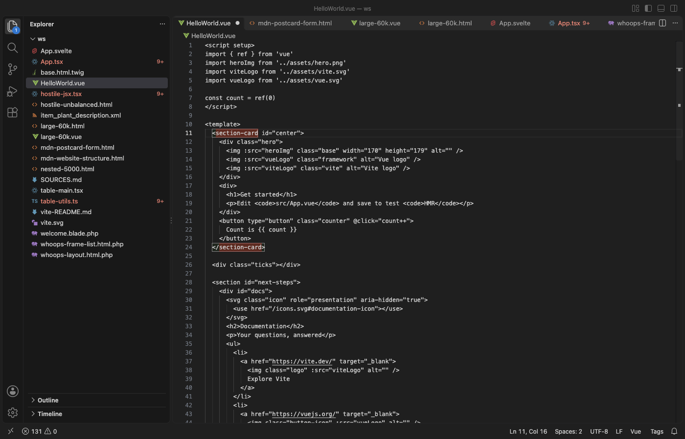
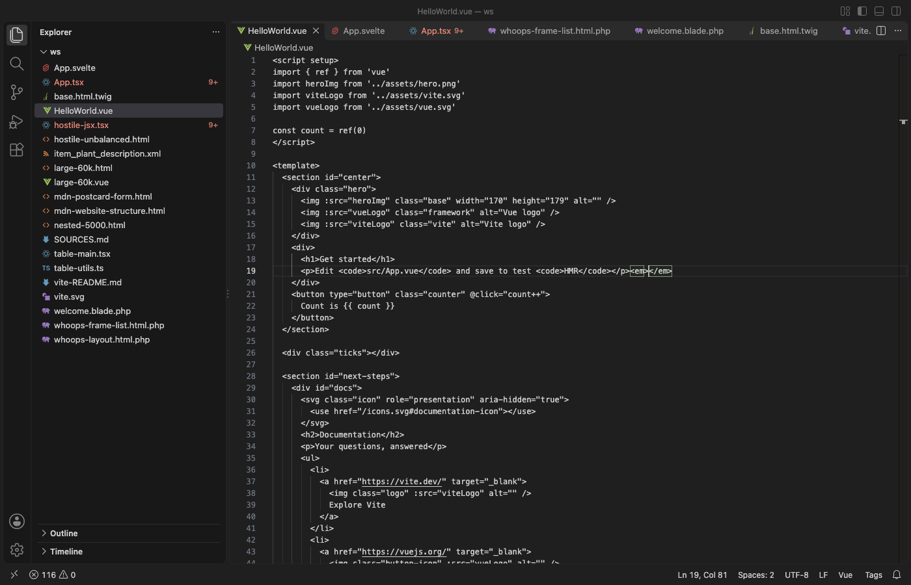

# Auto Rename Tag & Auto Close Tag (Highlight Matching Tag, JSX, Vue)

Rename a tag and its matching tag changes as you type. Type `>` and the closing tag is there. One undo brings everything back. Works in HTML, JSX and TSX, Vue, Svelte, Astro, PHP, Blade, Twig, Jinja, ERB, Handlebars, XML, SVG and Markdown. Free, no sign-in, works offline.

## What it fixes

The well-known tag extensions have open reviews about the same few problems. This one is built around them:

| Problem people report | What this extension does |
|---|---|
| "This will destroy your undo stack", "can corrupt your UNDO stack" | Rename uses VS Code's own linked editing, so your edit and the matching tag are one undo step. The closing tag joins the same undo step as the `>` you typed (HTML, Vue, Svelte, PHP, Blade, Twig, XML, Markdown and the rest). |
| ` ` turned into `  `, `Observable<boolean>` turned into `Observable<boolean></boolean>` | Void tags (`br`, `img`, `input`, `meta`, `hr` and the rest) never pair and are never closed. `.ts` files are left alone, and in `.tsx` only real JSX is a tag: comparisons like `a < b && c > d`, generics like `useState<string>()` or `<T,>` are not. |
| "Doesn't work in JSX", "not working well in mixed PHP and Twig", "doesn't work in a newly created document" | One scanner for HTML, JSX/TSX, Vue, Svelte, Astro, PHP, Blade, Twig/Jinja/Nunjucks/Liquid, ERB/EJS, Handlebars, XML, SVG and Markdown. It skips comments, strings, `<script>` and `<style>` bodies, `{{ }}`, ``, `<?php ?>` and `<% %>` blocks. New unsaved files work as soon as they have a language. |
| "You won't see what is auto renamed" | The matching tag gets a box in your theme's bracket colors whenever the cursor is on a tag. |
| "The lag between typing `</` and the tag being closed is too big", "VSCode hangs" | Closing runs right in the typing event: about 6 ms on a 10,000-line, 700 KB file. Files over 1 MB or 50,000 lines get no live rename or close, and the status bar says so, so typing never waits. |
| Pop-ups and course adverts | No ads, no tips, no notifications. The only question it ever asks is for a rating, after you have used it in two sessions, and you can turn that off. |

## Features

- Auto rename tag: change `
` and `
` follows, and the other way round.
- Auto close tag: type `<section class="x">` and `</section>` appears after the cursor. Type `</` and the open element's name is filled in.
- Highlight matching tag: a box around both tags of the element under the cursor.
- Go to Matching Tag and Select Tag Content (run it again to select the whole element, then its parent), in the right-click menu and the Command Palette.
- Rename Tag Pair…: type a new name in a box; both tags change in one edit.
- A small Tags item in the status bar shows what is on for the current file. Click it to turn the extension off for one language.

## Works with VS Code and your language extensions

- Rename is VS Code's linked editing (`editor.linkedEditing`), filled in for every language above. This extension turns `editor.linkedEditing` on for those languages. If you turned that setting off yourself, the status bar shows "Tags: rename off"; click it to turn it on for that language.
- Close: this extension closes tags in HTML, Vue, Svelte, Astro, PHP, Blade, Twig, Jinja, ERB, Handlebars, XML, SVG and Markdown. In HTML it sets VS Code's `html.autoClosingTags` to `false` by default (only while this extension is on), so a tag is never closed twice. In JSX and TSX, TypeScript closes tags itself and knows generics best, so this extension leaves closing to it; there TypeScript's closing tag is its own undo step. When the Vue, Svelte, Astro or Red Hat XML extension is installed, that extension closes tags in its language and this one stays out.
- If the older Auto Rename Tag or Auto Close Tag extension is also on, the status bar says so. Two renamers can edit the same tag twice, so keep one of them.

## Settings

| Setting | Default | What it does |
|---|---|---|
| `zovoTags.renameOnType` | `true` | Rename the matching tag as you type |
| `zovoTags.closeOnType` | `true` | Close tags on `>` and `</` where nothing else does |
| `zovoTags.highlightMatchingTag` | `true` | Box around the matching tag |
| `zovoTags.disabledLanguages` | `[]` | Language ids where the extension does nothing, for example `["markdown"]` |
| `zovoTags.additionalHtmlLanguages` | `[]` | More language ids to treat as HTML |
| `zovoTags.maxFileSizeKB` / `zovoTags.maxFileLines` | `1024` / `50000` | Above these, live rename, close and highlight are off for that file |
| `zovoTags.showStatusBar` | `true` | The Tags item in the status bar |
| `zovoTags.askForRating` | `true` | One rating question after real use in two sessions |

## Privacy

No network requests, no telemetry, no account. The extension reads only the open file, in memory. Links in the tooltip open a web page only when you click them.

## Known limits

- In `.tsx`, `<T>(x: T) => x` in a type and `<T extends X>` are read as generics, as TypeScript does. A JSX element named with one capital letter right before `(` is read as a generic too.
- `<?php if ($a): ?>
<?php else: ?>
<?php endif; ?>
` has two open tags for one closing tag; only the second pairs with it, so renaming the first changes nothing else.
- Tags written inside Svelte or Astro `{...}` expressions are not renamed.

## Support Zovo

Zovo extensions are free, with no ads and no tracking. They are made by [theluckystrike](https://github.com/theluckystrike) on GitHub. If this one saves you time, you can support the work:

- [Sponsor on GitHub](https://github.com/sponsors/theluckystrike)
- [Follow theluckystrike on GitHub](https://github.com/theluckystrike)

## More tools by Zovo

- [SVG Viewer & SVG Preview (Zoom, PNG Export)](https://marketplace.visualstudio.com/items?itemName=zovo.zovo-svg-viewer) previews SVG files beside the editor, with zoom and PNG export.
- [Large JSON Viewer, JSON Browser & JSON Tree](https://marketplace.visualstudio.com/items?itemName=zovo.zovo-json-tree-viewer) shows large JSON files as a searchable tree, copies JSONPath and turns arrays of objects into a table.
- [Font Viewer, TTF Viewer, OTF & WOFF Viewer, Font Preview](https://marketplace.visualstudio.com/items?itemName=zovo.font-viewer-vscode) opens TTF, OTF, WOFF, WOFF2 and TTC fonts with a glyph grid, a type tester with variable axes and the license fields.
- [HAR Viewer & HAR File Analyzer (HTTP Archive, Network Log)](https://marketplace.visualstudio.com/items?itemName=zovo.zovo-har-viewer) opens HAR files from browser DevTools with a timing waterfall, filters and a redacted copy for sharing.
- [Mermaid Viewer & Mermaid Preview (MMD Diagram, No Sign-In)](https://marketplace.visualstudio.com/items?itemName=zovo.mermaid-viewer) previews Mermaid diagrams in .mmd files and Markdown and exports SVG or PNG.

See [all Zovo extensions on the Marketplace](https://marketplace.visualstudio.com/publishers/zovo).

## License

MIT
